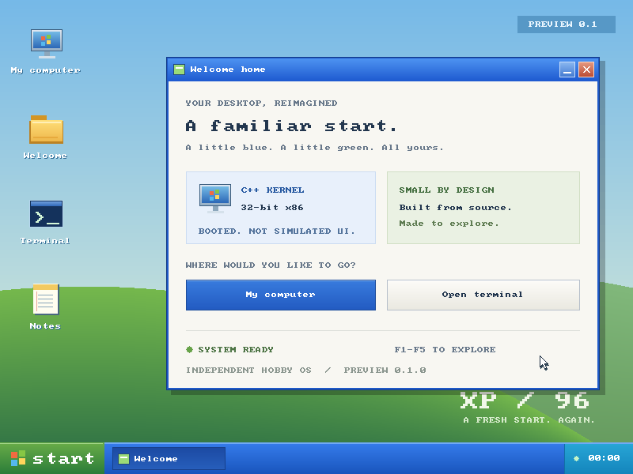

<div align="center">

# XP / 96

### Знакомое настроение. Совсем твоя система.

**Собственная загружаемая ОС · C++17 + Python 3 · x86 / BIOS**

[Запуск на Windows](#-запуск-на-windows) · [Запуск на Linux](#-запуск-на-linux) · [Управление](#-управление) · [Все файлы](#-где-какой-код)



*Немного синего. Немного зелёного. И своё маленькое ядро.*

</div>

> **Статус: 0.1.0 — первый учебный прототип.** Это независимая ОС, а не Windows, не дистрибутив Linux и не HTML-макет. В браузере эмулятор v86 исполняет тот же загрузочный образ, который можно открыть в QEMU. Совместимости с EXE нет.

## Что уже работает

- Загрузка с виртуального IDE-диска: BIOS → два этапа загрузчика → ядро C++.
- 32-битный защищённый режим, обработчик исключений и таймер PIT 100 Гц.
- Графика VBE 800 × 600, оригинальные процедурные обои, значки и указатель мыши.
- Меню Start, перетаскивание, закрытие и сворачивание окон; восстановление через панель задач.
- Приветствие, просмотр встроенных файлов, терминал, заметки и сведения о системе.
- Сборка и запуск с помощью Python. Для самого ядра Python не нужен.
- Автотесты структуры образа и настоящей загрузки с вводом клавиатуры и мыши.

**Пока нет:** установки на диск, UEFI, дисковой файловой системы, процессов, сети, звука, USB-драйверов и запуска сторонних программ. Все «приложения» пока являются частями одного ядра. Заметки хранятся **только в ОЗУ** и пропадают после перезагрузки. Язык интерфейса и раскладка внутри ОС — английские / US.

---

## 🪟 Запуск на Windows

### Готовая ОС — без WSL, Linux и компиляции

1. Установи **[QEMU для Windows](https://www.qemu.org/download/#windows)**. Стандартная папка — `C:\Program Files\qemu`.
2. Открой **[Actions → Build and boot](https://github.com/denis01812-cmd/Xp-windows-96/actions/workflows/build.yml)** и выбери новую успешную сборку для ветки `arena/42613a73-xp-windows-96`.
3. Внизу в **Artifacts** скачай **`xp96-windows`**. Нужен именно этот артефакт, а не `Code → Download ZIP` с исходниками.
4. Нажми по архиву правой кнопкой → **«Извлечь всё…»**. Сохрани папку `tools` и остальные файлы рядом с образом.
5. Дважды щёлкни **`Start-XP96.bat`** — откроется ОС в QEMU.

**Python, npm, Git и WSL для готового архива не нужны.** Это запуск гостевой ОС в отдельном окне, не установка вместо Windows. `Ctrl+Alt` освобождает мышь; закрытие окна QEMU завершает работу.

Запускатель ищет QEMU в `PATH` и Program Files; поддерживает `qemu-system-i386.exe` и `qemu-system-x86_64.exe`. Если он установлен нестандартно:

```powershell
.\Start-XP96.bat -QemuPath "D:\Programs\qemu\qemu-system-i386.exe"
```

**[Подробная инструкция для Windows со всеми шагами и ошибками →](docs/WINDOWS.md)**

### Если хочешь собирать исходники на Windows

Для **сборки**, а не просто запуска готовой ОС, используй **Ubuntu в WSL**. Сначала сделай это один раз:

1. Открой **PowerShell от имени администратора**.
2. Выполни:

   ```powershell
   wsl --install -d Ubuntu
   ```

3. Перезагрузи компьютер, если Windows попросит. Открой **Ubuntu** из меню «Пуск» и создай имя пользователя и пароль Linux. Пароль вводится без звёздочек — это нормально.
4. Дальше выполняй команды из раздела **«Запуск на Linux» в окне Ubuntu**, не в PowerShell.
5. Когда сервер превью запустится, открой в обычном браузере Windows: **http://localhost:8000**.

> Для работы графического QEMU через WSL нужен WSLg, обычно доступный в Windows 11. Если графическое окно не открывается, используй браузерный вариант ниже — ему WSLg не нужен. ОС запускается внутри эмулятора и не заменяет твою Windows.

## 🐧 Запуск на Linux

Ниже команды для **Ubuntu / Debian**, а также Ubuntu в WSL. Для других систем нужны аналогичные GNU GCC/G++, Binutils и Python 3.10+.

### 1. Установи инструменты

```bash
sudo apt update
sudo apt install -y git python3 build-essential nodejs npm
```

`nodejs` и `npm` нужны только для загрузки браузерного эмулятора. Ядро собирается без Node.js и без сторонних Python-библиотек. Автотесты эмулятора проверены с Node.js 22.

### 2. Скачай исходники

**Код сейчас находится в ветке `arena/42613a73-xp-windows-96`, не в `main`.** Клонируй именно её:

```bash
git clone --branch arena/42613a73-xp-windows-96 https://github.com/denis01812-cmd/Xp-windows-96.git
cd Xp-windows-96
```

Без Git тоже можно: на GitHub выбери эту ветку → **Code → Download ZIP**, распакуй архив и открой терминал в папке с `README.md`.

### 3. Собери настоящий загрузочный образ

```bash
python3 tools/build.py
```

В конце появится `Ready: .../build/xp96.img`. Это виртуальный диск размером **2 МиБ**. Скрипт также создаст `kernel.elf`, карту линковки и `manifest.json` с SHA256 образа.

### 4. Открой ОС в браузере

```bash
npm ci --ignore-scripts
python3 tools/fetch_bios.py
python3 tools/preview.py
```

Перейди на **http://localhost:8000**. Дождись надписи **«ЯДРО РАБОТАЕТ»** — рабочий стол запустится автоматически.

- Нажми на экран ОС, чтобы передавать ей ввод с клавиатуры.
- Кнопки **F1–F5 под экраном** открывают приложения, даже если браузер перехватывает функциональные клавиши.
- **«Захватить мышь»** включает относительное управление указателем. `Esc` освобождает захват.
- Сверху есть пауза, перезагрузка и полноэкранный режим. Эти возможности могут ограничиваться браузером или встраивающей страницей.
- Внизу можно скачать собранный `xp96.img`.
- Чтобы остановить сервер, нажми **Ctrl+C в терминале**.

`npm ci` и загрузка BIOS нужны только при первой настройке. После изменения C++ достаточно снова выполнить `python3 tools/build.py` и обновить страницу. Для полной работы после первоначальной настройки интернет не требуется.

> Сервер по умолчанию слушает `0.0.0.0:8000`, чтобы работать в удалённом превью. Для доступа только с собственного компьютера запусти `python3 tools/preview.py --host 127.0.0.1`. Сервер отдаёт только явно разрешённые файлы превью, а не `.git` или весь репозиторий.

### Альтернатива: запуск в QEMU без браузера

```bash
sudo apt install -y qemu-system-x86
python3 tools/run.py
```

`run.py` сам пересоберёт образ и откроет эмулятор. **Для этого варианта не нужны npm, v86 и скачивание BIOS скриптом.**

Если образ уже готов, можно запустить его вручную:

```bash
qemu-system-i386 -machine pc -cpu qemu32 -m 64M -vga std \
  -drive file=build/xp96.img,format=raw,if=ide -boot c -serial stdio
```

В QEMU комбинация **Ctrl+Alt** освобождает захваченную мышь. Для лога без графического окна есть `python3 tools/run.py --headless` — это режим диагностики, а не рабочий стол.

**Не записывай образ на настоящий диск или флешку.** Первая версия предназначена только для виртуальной машины с BIOS, IDE, PS/2 и стандартной VBE-графикой.

## 📦 Готовый образ из GitHub Actions

Если не хочешь компилировать:

1. Открой вкладку **[Actions](https://github.com/denis01812-cmd/Xp-windows-96/actions)**.
2. Найди успешный запуск **Build and boot** для ветки `arena/42613a73-xp-windows-96`.
3. Для **Windows** скачай **`xp96-windows`**, распакуй весь ZIP и запусти `Start-XP96.bat` после установки QEMU — [подробно](docs/WINDOWS.md). Для других систем есть **`xp96-image`** с одним образом и диагностикой. Для скачивания артефактов GitHub может потребоваться вход в аккаунт.
4. Для ручного запуска образа установи [QEMU](https://www.qemu.org/download/) и открой терминал в папке с распакованным `xp96.img`:

   ```bash
   qemu-system-i386 -m 64M -vga std -drive file=xp96.img,format=raw,if=ide -boot c
   ```

   На Windows выполни эту же команду в PowerShell, если QEMU добавлен в `PATH`. Иначе укажи полный путь к `qemu-system-i386.exe`.

Артефакты появляются после успешной CI-проверки и хранятся 14 дней. Если артефакт истёк или Actions отключены, собери образ локально по инструкции выше.

## ⌨ Управление

| Действие | Клавиша / способ |
|---|---|
| Открыть приложение | Один щелчок по значку или пункту Start |
| Приветствие / файлы / терминал / заметки / система | `F1` / `F2` / `F3` / `F4` / `F5` |
| Открыть или закрыть Start | Клавиша Windows или кнопка Start |
| Закрыть меню Start | `Esc` |
| Переместить окно | Потяни за заголовок мышью |
| Свернуть / закрыть окно | Кнопки `_` / `×` в заголовке |
| Восстановить окно | Нажми его кнопку на панели задач |
| Переключить открытые несвёрнутые окна | `Tab` |
| Закрыть активное окно | `Alt+F4` |
| Выполнить команду терминала | `Enter` |
| Предыдущая команда | Стрелка вверх |
| Очистить вывод терминала | `Ctrl+L` или команда `clear` |
| Попытка сохранить заметку | `Ctrl+S` покажет предупреждение: сохранения на диск пока нет |
| Перезагрузить ОС | `reboot`, Restart в Start или `Ctrl+Alt+Delete` в гостевой системе |

Часы справа на панели задач показывают **время работы ОС в минутах и секундах**, а не местное время. Не отправляй `Ctrl+Alt+Delete` из браузера обычной клавиатурой: эту комбинацию может перехватить твоя основная ОС; используй команду `reboot`.

### Команды терминала

```text
help               список команд
about              версия и описание
info               сведения о ядре и устройствах
uptime             время после загрузки
ls                 встроенные виртуальные файлы
cat WELCOME.TXT    краткая инструкция
cat SYSTEM.TXT     сведения о реализации
cat NOTES.TXT      содержимое заметок из ОЗУ
notes              открыть заметки
echo Hello!        вывести текст
clear              очистить терминал
reboot             перезагрузить гостевую ОС
```

Имена команд и файлов **чувствительны к регистру**. `ls` показывает встроенный каталог, а не файлы на диске твоего компьютера. Заметки поддерживают ввод в конец, Enter и Backspace; курсорный редактор ещё не реализован.

## 🗂 Где какой код

```text
Xp-windows-96/
├── Start-XP96.bat           # Windows: запуск готового образа двойным щелчком
├── boot/
│   ├── boot.S               # BIOS: первый сектор, загрузка второго этапа
│   └── loader.S             # Загрузка ядра, VBE, A20, GDT, protected mode
├── kernel/
│   ├── entry.S              # Вход в ядро, очистка BSS, обработчики IRQ/ошибок
│   ├── main.cpp             # Главная функция и цикл ядра
│   ├── hardware.hpp/.cpp    # COM1, IDT, PIC, PIT, PS/2, перезагрузка
│   ├── graphics.hpp/.cpp    # Рисование, шрифт, обои, вывод framebuffer
│   ├── desktop.hpp/.cpp     # Рабочий стол, окна, терминал и заметки
│   ├── runtime.cpp          # Минимальные функции памяти и строк
│   ├── types.hpp            # Собственные типы без стандартной библиотеки
│   ├── font8x8.hpp          # Public-domain растровый шрифт с указанием авторов
│   └── linker.ld            # Размещение секций ядра в памяти
├── tools/
│   ├── build.py             # Python: компиляция и сборка xp96.img
│   ├── run.py               # Python: сборка и запуск QEMU
│   ├── run-windows.ps1      # Windows PowerShell: поиск QEMU, без сборки и WSL
│   ├── package_windows.py   # Python: готовый ZIP для Windows с проверкой SHA256
│   ├── fetch_bios.py        # BIOS для v86: фиксированная версия и проверка SHA256
│   └── preview.py           # Python: сервер браузерного превью
├── tests/
│   ├── test_build.py        # Проверки образа и безопасности путей превью
│   ├── boot.mjs             # Настоящая загрузка и ввод в x86-эмуляторе
│   ├── test_windows_package.py # Проверки комплектации и целостности Windows ZIP
│   ├── windows-launcher.ps1 # Нативные Windows-тесты сценария запуска
│   └── windows-qemu.ps1     # Настоящая загрузка в Windows QEMU с кириллицей в пути
├── web/                     # Только оболочка эмулятора, НЕ реализация ОС
│   ├── index.html
│   ├── style.css
│   ├── app.js
│   └── favicon.svg
├── docs/
│   ├── desktop.png          # Реальный скриншот загруженного ядра
│   ├── ARCHITECTURE.md      # Как устроены загрузка, память и события
│   └── WINDOWS.md           # Запуск на Windows без WSL, шаг за шагом
├── .github/workflows/build.yml
├── .editorconfig
├── .gitignore
├── package.json
├── package-lock.json
├── THIRD_PARTY.md
└── README.md
```

**Все авторские исходники находятся в GitHub.** `build/`, `node_modules/` и `.cache/` намеренно не публикуются в Git: это результаты сборки и скачиваемые зависимости. Они воспроизводятся командами из инструкции; готовый образ CI кладёт в Artifacts. Небольшой ассемблерный код необходим для старта процессора и IRQ; основная логика написана на C++, инструменты — на Python.

Подробнее: **[архитектура](docs/ARCHITECTURE.md)** · **[сторонние компоненты](THIRD_PARTY.md)**.

## 🧪 Проверка проекта

После настройки браузерного эмулятора:

```bash
python3 tools/build.py
npm test
```

Тесты проверяют разметку образа, лимиты загрузчика, закрытые HTTP-пути, реальную загрузку BIOS, защищённый режим, графику, PS/2, меню Start, команды, ограничение длины ввода, прокрутку, заметки, окна и повторную загрузку. Эталонный скриншот не обновляется автоматически:

```bash
node tests/boot.mjs --update-screenshot
```

Автосборка GitHub Actions сохраняет образ, готовый архив **`xp96-windows`**, ELF, SHA256-манифест, скриншоты и лог загрузки. Windows-запускатель отдельно проверяется на **Windows**: поиск QEMU, передача аргументов через `.bat` и PowerShell, пути с пробелами и кириллицей, сообщения об ошибках. Для проверок аргументов и ошибок используется тестовый исполняемый файл. Затем CI устанавливает **настоящий Windows QEMU** с проверкой SHA256 и проверяет загрузку до рабочего стола из папки с кириллицей, с русским именем образа и кириллицей в `TEMP`. Полное взаимодействие с рабочим столом дополнительно проверяется в **v86**.

## Если что-то не запускается

| Проблема | Что сделать |
|---|---|
| `g++`, `gcc`, `ld` или `objcopy` не найдены | Установи `build-essential` и `binutils` в Ubuntu / Debian |
| В Windows не работает `python3` или Linux-команды | Выполняй их в окне **Ubuntu (WSL)**, а не в PowerShell |
| `QEMU not found` | `sudo apt install qemu-system-x86` или используй браузерный вариант |
| `Preview dependencies are missing` | Выполни сборку, `npm ci --ignore-scripts` и `python3 tools/fetch_bios.py` |
| Ошибка скачивания BIOS / GitHub API rate limit | Проверь доступ к GitHub и повтори позже; проверенные файлы кешируются |
| Порт 8000 занят | `python3 tools/preview.py --port 8001`, затем открой порт 8001 |
| Windows: `Could not open ... xp96.img` | QEMU уже найден. Скачай исправленный запускатель; для старого архива перенеси всю папку проекта в `D:\XP96` без кириллицы в пути — [подробнее](docs/WINDOWS.md) |
| Чёрный экран в QEMU | Используй именно IDE-образ, BIOS и `-vga std`, не UEFI / AHCI |
| F1–F5 открывают функции браузера | Используй кнопки под экраном, либо щёлкни по экрану перед вводом |
| Не печатается русский текст | Переключи раскладку на **English (US)**; кириллицы пока нет |
| Мышь неудобно движется | Нажми «Захватить мышь»; в браузере захват освобождается через `Esc` |
| После перезагрузки исчезла заметка | Так и задумано в 0.1: дисковое сохранение ещё не реализовано |

---

<div align="center">

**C++ внутри. Любопытство снаружи.**

*XP / 96 не связан с Microsoft. Обои и элементы интерфейса созданы для этого проекта; файлы Windows не используются.*

</div>
